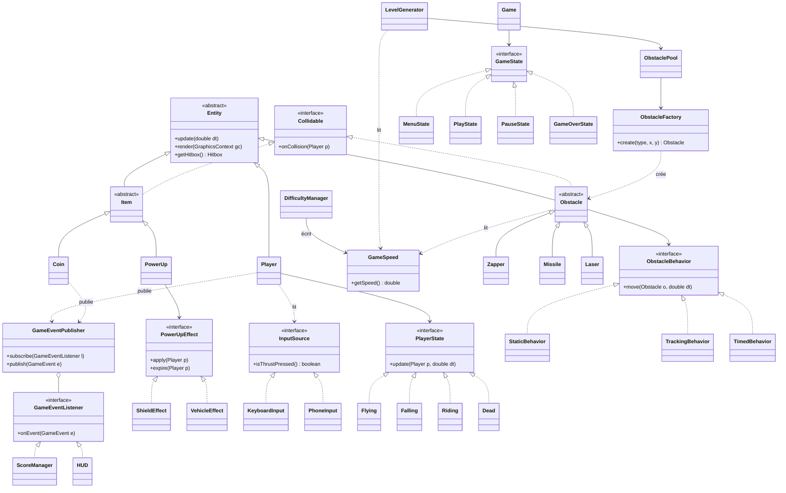

# Game Design Document

## Équipe

| Rôle | Membre | Périmètre |
| --- | --- | --- |
| A : le joueur | Sofia | Jetpack, états du joueur, Shield, Vehicle |
| B : les dangers | Sarra | Zapper, Missile, Laser, `ObstacleFactory`, `ObstaclePool` |
| C : le monde | Kathleen | Générateur de niveau, difficulté, Coin, score, états du jeu |

## Concept

Jeu de course sans fin en vue de côté, inspiré de Jetpack Joyride, développé en Java avec JavaFX. Le joueur contrôle un personnage équipé d'un jetpack : il maintient une touche pour monter, la relâche pour redescendre, et évite les obstacles d'un décor qui défile tout seul.

- **Genre :** runner à défilement automatique (endless runner), 2D side-view
- **Objectif du projet :** démontrer la maîtrise de la POO (héritage, polymorphisme, design patterns) via un POC jouable
- **Public :** joueurs occasionnels, parties de 1 à 3 minutes, une seule touche
- **Priorité :** le gameplay avant les graphismes, comme demandé dans le sujet

## Gameplay

Une partie dure jusqu'à la première collision mortelle. Le score se calcule ainsi :

```
score = distance parcourue (en mètres) + 10 × pièces ramassées
```

1. Le décor défile de droite à gauche et accélère progressivement.
2. Le joueur maintient la touche pour monter ; dès qu'il la relâche, la gravité le fait redescendre. Le sol et le plafond le bloquent sans le tuer.
3. Des obstacles arrivent par tronçons de niveau tirés au hasard.
4. Toucher un obstacle tue le joueur, sauf s'il a un bouclier (consommé par le choc) ou un véhicule (perdu par le choc).
5. Les pièces ramassées augmentent le score ; à la mort, l'écran de fin affiche la distance, les pièces, le score et le meilleur score de la session.

**Contrôles**

| Action | Touche |
| --- | --- |
| Monter (jetpack) | Espace (maintenir) |
| Quitter/Pause | Échap |
| Rejouer (écran de fin) | Entrée |

Le jeu se joue entièrement au clavier sur PC. En bonus, un téléphone peut servir de manette pour « monter » (voir Bonus).

**Règles**

- La vitesse du décor augmente par paliers jusqu'à un plafond. Elle est pilotée par `DifficultyManager` (C) qui écrit dans `GameSpeed`.
- Un missile est annoncé par une alerte avant son arrivée.
- Un tronçon ne doit jamais rendre le passage impossible (vérifié par un test automatique, voir Tests).
- Les valeurs (vitesse, gravité, durées) sont à équilibrer pendant les tests.

## Obstacles et items

Trois types d'obstacles et trois types d'items, chacun avec un comportement propre. Les valeurs sont des points de départ à équilibrer pendant les tests.

| Obstacle | Comportement (`ObstacleBehavior`) | Effet |
| --- | --- | --- |
| Zapper | `StaticBehavior` : immobile, posé à l'horizontale, à la verticale ou en diagonale | Tue au contact |
| Missile | `TrackingBehavior` : alerte, puis fonce en ligne droite à la hauteur du joueur au moment du tir | Tue au contact |
| Laser | `TimedBehavior` : alterne une phase d'avertissement et une phase active | Tue au contact tant qu'il est actif |

| Item | Effet | Durée |
| --- | --- | --- |
| Coin | +1 pièce et +10 au score | Instantané |
| Shield (`PowerUp` + `ShieldEffect`) | Absorbe une collision mortelle | Jusqu'au premier choc |
| Vehicle (`PowerUp` + `VehicleEffect`) | Remplace le jetpack par un saut et absorbe une collision | 10 secondes |

Chaque obstacle délègue son déplacement à une `ObstacleBehavior` (Strategy) et chaque power-up délègue son effet à une `PowerUpEffect` (Strategy). Les deux redéfinissent `onCollision(Player)` : ajouter un nouveau type ne demande aucune modification des classes existantes.

## Interface

Quatre écrans, tous dans la même fenêtre JavaFX de 1280 × 720.

1. **Menu principal** : Jouer, Quitter
2. **Jeu** : décor, joueur et HUD
3. **Pause** : Reprendre, Quitter
4. **Fin de partie** : distance, pièces, score, meilleur score de la session, rejouer

**HUD en jeu**

- Score (distance + pièces) en haut à gauche
- Pièces ramassées en haut à droite
- Icône du bouclier ou du véhicule actif, avec le temps restant
- Alerte missile sur le bord droit, à la hauteur du tir
- Meilleur score de la session

## Assets

Pour tenir en 27 jours, les visuels commencent en formes colorées (joueur, obstacles, items) et sont remplacés par des sprites libres de droits uniquement si le gameplay est terminé.

| Asset | Version de départ | Version finale | Source |
| --- | --- | --- | --- |
| Sprite du joueur | Rectangle coloré | Sprite sheet libre | itch.io, OpenGameArt (licence à vérifier) |
| Obstacles et items | Formes colorées | Sprites libres | itch.io, OpenGameArt (licence à vérifier) |
| Décor | Fond uni qui défile | Image en boucle | OpenGameArt |
| Sons (pièce, choc), bonus | Aucun | Effets courts libres | freesound.org (licence à vérifier) |
| Polices HUD | Police système | Police libre | Google Fonts |

Chaque asset utilisé est listé avec sa licence dans le README.

## Architecture

`Player`, `Obstacle` et `Item` héritent d'`Entity` (position, `update`, `render`, `getHitbox`). `Obstacle` et `Item` implémentent `Collidable` et réagissent chacun à leur manière aux collisions (polymorphisme).



| Pattern | Utilisation | Responsable |
| --- | --- | --- |
| State | États du joueur (`Flying`, `Falling`, `Riding`, `Dead`) | A |
| Strategy | Effets des power-ups (`PowerUpEffect` : `ShieldEffect`, `VehicleEffect`) | A |
| Factory | Création des obstacles (`ObstacleFactory`) | B |
| Strategy | Comportement de chaque obstacle (`ObstacleBehavior` : fixe, qui vise, qui s'active) | B |
| Object Pool | Réutilisation des obstacles qui sortent de l'écran (`ObstaclePool`) | B |
| Observer | Score et pièces vers le HUD (`GameEventPublisher` / `GameEventListener`) | C |
| State | Menu, jeu, pause, fin de partie (`GameState`) | C |
| Adapter | Manette téléphone derrière l'interface `InputSource` (bonus) | A |

## Répartition du travail

### Socle commun (les 3, session 1)

- GDD et UML
- Game loop, `Entity`, `Collidable`, `Hitbox`, collisions de base, rendu minimal
- `InputSource` (`isThrustPressed()`) avec le clavier (`KeyboardInput`) comme première implémentation
- Interfaces figées avant de se séparer (tableau ci-dessous)

### Par personne

| | A : Sofia, le joueur | B : Sarra, les dangers | C : Kathleen, le monde |
| --- | --- | --- | --- |
| **Contenu** | Jetpack (poussée, gravité, inertie), Shield, Vehicle | Zapper, Missile, Laser avec avertissement, comportements fixe / qui vise / qui s'active | Générateur de niveau, difficulté progressive, Coin, score, high score, game over et restart |
| **Branches** | `feat/jetpack-physics`, `feat/player-state`, `feat/shield`, `feat/vehicle` | `feat/obstacle-factory`, `feat/obstacle-zapper`, `feat/obstacle-missile`, `feat/obstacle-laser`, `feat/obstacle-pool` | `feat/level-generator`, `feat/difficulty`, `feat/coins-score`, `feat/game-states` |

Le socle commun est dans `feat/base-classes`. Menus et HUD : à la fin, par celui qui finit en premier. Armes et gadgets : bonus après le gel.

### Interfaces à figer en session 1

| Point de contact | Entre | À définir |
| --- | --- | --- |
| `Player` | A et B | Ce que B lit pour viser (position, hitbox) et `onCollision(Player)` |
| Spawner | B et C | C appelle la `Factory` de B (`create(type, x, y)`), jamais de construction directe d'un obstacle |
| Score | A et C | Événements publiés (pièce ramassée, mort) que les `GameEventListener` de C écoutent |
| Vitesse du décor | A et C | Une seule source (`GameSpeed`), écrite par `DifficultyManager` (C), lue par tout le monde |
| Entrée du joueur | Socle et A | `Player` lit l'entrée uniquement via `InputSource`, jamais le clavier directement |

### Règles de travail

- `main` est protégée : on y entre uniquement par pull request relue par un autre membre.
- Branches courtes (2 à 3 jours max), mergées dès que ça marche.
- Chacun écrit ses tests et sa Javadoc dans sa branche.
- Les documents (GDD, UML) vivent dans `docs/`.
- Chacun relit au moins une PR par jour.
- B pousse `feat/obstacle-factory` avec un `create(type, x, y)` fonctionnel (même avec des obstacles vides) dès le début de la phase de développement.
- Pour C, commencer avec un obstacle factice (rectangle) puis brancher ceux de B.

## Tests

- **Outils :** JUnit + JaCoCo.
- **Objectif de couverture :** 70 % minimum sur la logique du jeu (entités, collisions, spawn, score, états). L'affichage JavaFX est exclu du calcul.
- **Logique séparée du rendu :** les classes de logique ne dépendent pas de JavaFX, pour pouvoir les tester sans interface.
- **Test des tronçons :** un test automatique vérifie que chaque tronçon du générateur laisse un passage franchissable (hauteur libre minimale pour le joueur).
- **Tests prioritaires :** collisions et effets (Shield, Vehicle), comportements d'obstacles, formule du score, transitions d'états.

## Périmètre

| Dans le jeu | Hors périmètre |
| --- | --- |
| 1 niveau infini, tronçons tirés au hasard | Plusieurs décors ou biomes |
| 1 personnage jouable | Personnalisation, boutique |
| 3 obstacles et 3 items | Boss, missions |
| Score local (distance, pièces) | Classement en ligne |
| Tests unitaires + couverture JaCoCo | Animations complexes |

## Bonus

Les bonus sont des add-ons : le jeu est complet et jouable sans eux. Ils ne démarrent qu'après le gel des fonctionnalités et ne sont mergés que si les tests passent. Ils ne bloquent jamais une PR du jeu principal.

| Bonus | Responsable | Branche | Principe |
| --- | --- | --- | --- |
| Manette téléphone | A définir | `feat/bonus-phone-controller` | Le jeu lance un serveur WebSocket. Le téléphone, sur le même réseau, ouvre une page web servie par le PC avec un gros bouton « monter ». Appui et relâche arrivent au jeu via `PhoneInput` (Adapter de `InputSource`). Le jeu tourne et s'affiche sur le PC, le téléphone ne sert que de manette |
| Sauvegarde du high score | A définir | `feat/bonus-highscore` | Le meilleur score est écrit dans un fichier et rechargé au lancement |
| Sons (pièce, choc) | A définir | `feat/bonus-sounds` | Un `GameEventListener` (Observer) joue un son sur les événements existants |

**Manette téléphone : points de vigilance**

- Le clavier reste toujours disponible : sans réseau ou sans téléphone, le jeu se joue normalement.
- Le test de latence (une page avec un bouton qui envoie un message au PC) se fait pendant la phase de développement, avant le gel. Si la latence est trop mauvaise, le bonus est abandonné.
- Le Wi-Fi de l'école bloque souvent la communication entre appareils : prévoir un partage de connexion depuis un téléphone pour la démo.