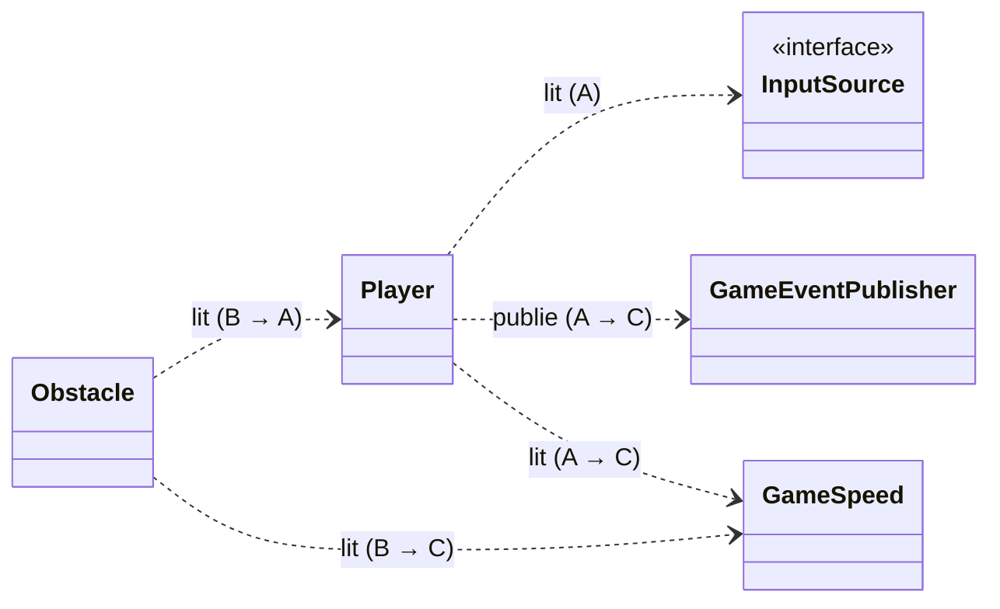

# Interface

 

| Interface | Fournie par | Utilisée par | Section |
| --- | --- | --- | --- |
| `Player` (vue lue par les dangers) | A | B | 1 |
| `ObstacleFactory.create(type, x, y)` | B | B (`ObstaclePool`), C (`PlayState`) | 2 |
| Événements de score (`GameEvent`) | C | A, B, C | 3 |
| `GameSpeed` | C | A, B, C | 4 |
| `InputSource` | A | A (`Player`), C (`Game`) | 5 |
 
**Conventions communes**
 
- Positions et tailles en pixels, origine en haut à gauche, `y` vers le bas.
- Temps en secondes (`double dt`).
- Le décor défile vers la gauche ; le joueur garde un `x` fixe à l'écran.
- Aucune zone ne garde de référence vers une classe concrète d'une autre zone : on passe toujours par les types de ce fichier.

 

 
## 1. `Player`

Les dangers n'ont accès qu'à ces méthodes. Tout le reste de `Player` (états, power-ups) est interne à A.
 
```java
public final class Hitbox {
    public Hitbox(double x, double y, double width, double height);
    public double getX();
    public double getY();
    public double getWidth();
    public double getHeight();
    public boolean intersects(Hitbox other);
}
 
public class Player extends Entity {
    public Hitbox getHitbox();   // hérité d'Entity
    public double getX();        // centre du joueur
    public double getY();        // utilisé par TrackingBehavior pour viser
    public boolean isAlive();    // false dans l'état Dead
    public void hit();           // appelé par Obstacle.onCollision
}
```
 Règles: 

- B appelle `hit()` quand un obstacle touche le joueur, et rien d'autre. C'est `Player` qui décide de la suite : avec un bouclier (`ShieldEffect`) il perd le bouclier, sinon il passe dans l'état `Dead`.
- `hit()` sur un joueur déjà mort ne fait rien.
- B ne lit jamais `PlayerState` ni `PowerUpEffect`.

## 2. `ObstacleFactory.create(type, x, y)`

```java
public enum ObstacleType { ZAPPER, MISSILE, LASER }
 
public class ObstacleFactory {
    public Obstacle create(ObstacleType type, double x, double y);
}
```
 
- `(x, y)` est le coin haut-gauche de l'obstacle, en coordonnées écran. Pour faire apparaître un obstacle hors de l'écran à droite, on passe `x >= largeur de la fenêtre`.
- `type` ne doit jamais être `null` : sinon `IllegalArgumentException`.
- La factory choisit seule la `ObstacleBehavior` de chaque type (`ZAPPER` → `StaticBehavior`, `MISSILE` → `TrackingBehavior`, `LASER` → `TimedBehavior`).
- Ajouter un obstacle, c'est ajouter une valeur à `ObstacleType` et un cas dans `create`. A et C n'ont rien à modifier.
- En pratique, le reste du jeu passe par `ObstaclePool`, qui appelle la factory quand il n'a plus d'obstacle libre :
```java
public class ObstaclePool {
    public Obstacle acquire(ObstacleType type, double x, double y);
    public void release(Obstacle o); // appelé quand l'obstacle sort de l'écran
}
```
## 3. Événements de score
 
Le score et le HUD n'écoutent que ces événements. Celui qui publie ne connaît pas ceux qui écoutent.
 
```java
public enum GameEventType {
    COIN_COLLECTED,   // value = nombre de pièces gagnées (1 par pièce)
    POWERUP_COLLECTED,// value = 0
    PLAYER_DIED       // value = 0
}
 
public final class GameEvent {
    public GameEvent(GameEventType type, int value);
    public GameEventType getType();
    public int getValue();
}
 
public interface GameEventListener {
    void onEvent(GameEvent e);
}
 
public class GameEventPublisher {
    public void subscribe(GameEventListener l);
    public void unsubscribe(GameEventListener l);
    public void publish(GameEvent e);
}
```
 
| Événement | Publié par | Quand |
| --- | --- | --- |
| `COIN_COLLECTED` | `Coin.onCollision` | le joueur touche une pièce |
| `POWERUP_COLLECTED` | `PowerUp.onCollision` | le joueur touche un power-up |
| `PLAYER_DIED` | `Player` | à l'entrée dans l'état `Dead` |
 
- La distance n'est pas un événement : `ScoreManager` la calcule lui-même à chaque frame avec `GameSpeed.getSpeed() * dt`.
- Il n'existe qu'un seul `GameEventPublisher` par partie. `Game` le crée et le donne aux constructeurs qui en ont besoin (pas de singleton global).

## 4. `GameSpeed`
La vitesse de défilement a une seule source de vérité.
 
```java
public class GameSpeed {
    public double getSpeed();          // pixels par seconde, toujours > 0
    void setSpeed(double pxPerSecond); // visibilité package : seul DifficultyManager écrit
}
```
 
- Tout ce qui défile (obstacles, pièces, décor) se déplace de `-getSpeed() * dt` en `x` à chaque frame.
- Valeurs de départ proposées pour `DifficultyManager` : 300 px/s au début, +5 px/s par seconde de jeu, plafonné à 900 px/s.
- `GameSpeed` revient à sa valeur de départ quand une nouvelle partie commence.

## 5. `InputSource`

`Player` ne lit jamais le clavier directement.
 
```java
public interface InputSource {
    void poll();               // une fois par frame, avant les update
    boolean isThrustPressed(); // jetpack : true tant que la touche est maintenue
    boolean isPausePressed();  // true seulement à la frame où l'appui commence
}
```
 
- `KeyboardInput` : barre espace ou clic gauche pour `isThrustPressed`, `Échap` pour `isPausePressed`.
- `PhoneInput` (bonus) implémente la même interface. Brancher la manette ne touche ni à `Player` ni à `Game`.
- `isPausePressed` est lu par `Game` (C) pour passer en `PauseState`.

## Ordre d'une frame (`PlayState.update(dt)`)
 
1. `input.poll()`
2. `difficultyManager.update(dt)` : met à jour `GameSpeed`
3. `player.update(dt)` : lit `InputSource`, applique l'état courant (A)
4. `levelGenerator.update(dt)` : fait apparaître des obstacles via `ObstaclePool` (B)
5. `update(dt)` de chaque obstacle et item, puis les obstacles sortis de l'écran sont rendus au pool
6. Collisions : pour chaque `Collidable` dont la hitbox touche celle du joueur, `onCollision(player)`
7. `scoreManager.update(dt)` : ajoute la distance
8. `render(gc)` de toutes les entités, puis du HUD
 