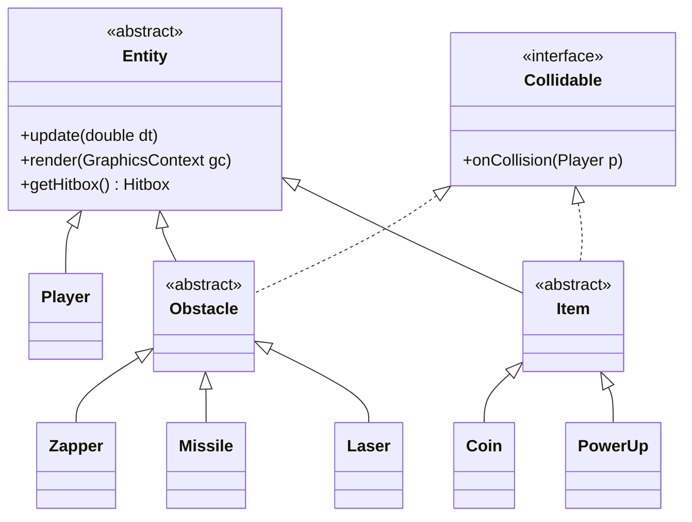
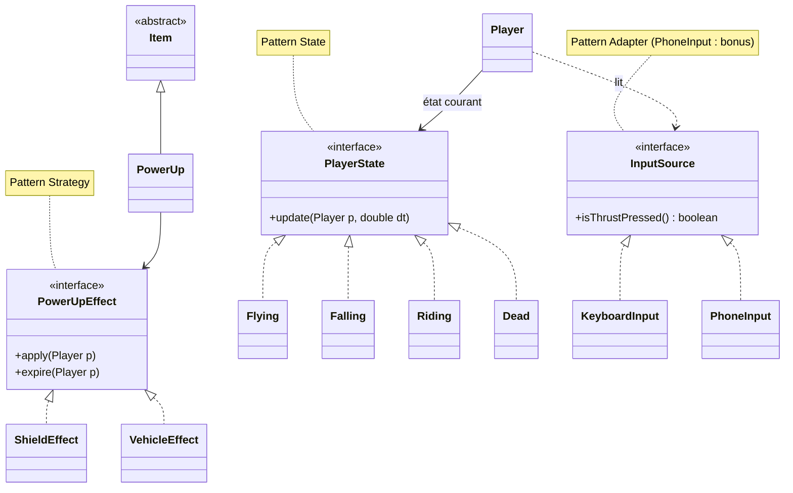
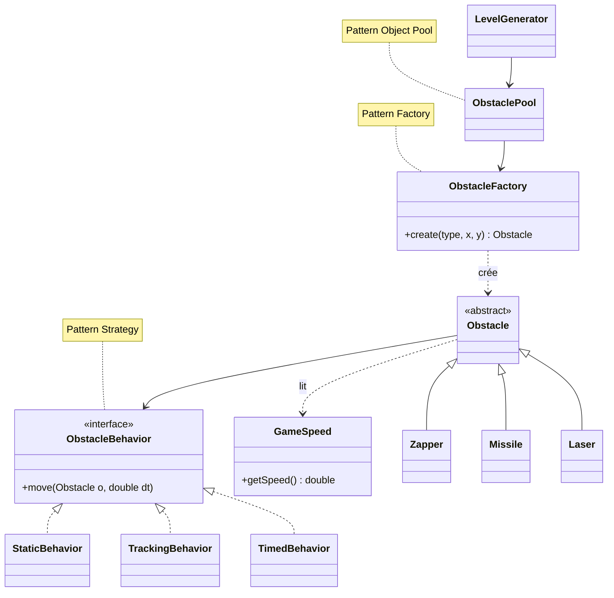
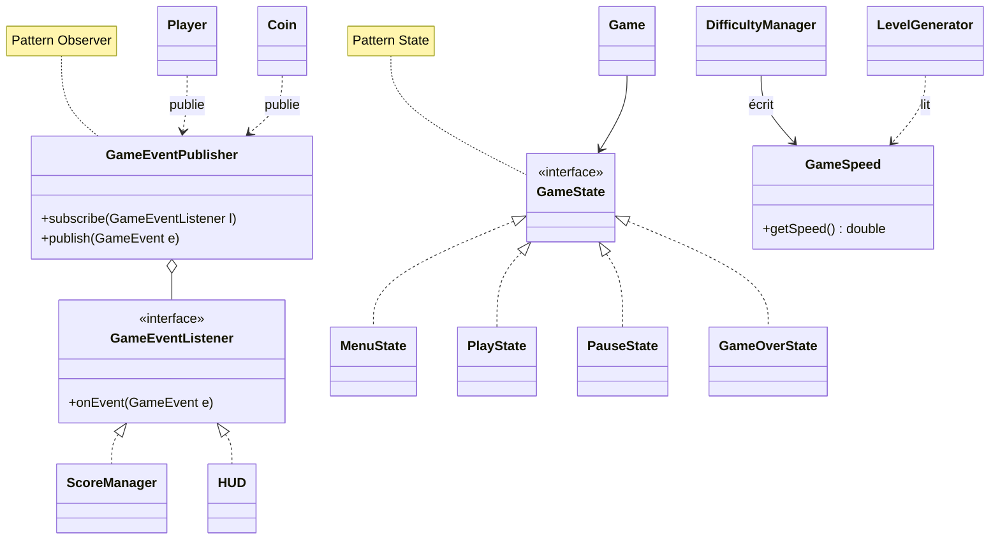

# UML : classes et design patterns

Diagrammes de classes de Jetpack Joyride, découpés par zone pour rester lisibles. Ils reprennent l'architecture du GDD (`docs/GDD.md`) et font apparaître chaque design pattern.

| Pattern | Utilisation | Responsable | Schéma |
| --- | --- | --- | --- |
| State | États du joueur (`Flying`, `Falling`, `Riding`, `Dead`) | A | 2 |
| Strategy | Effets des power-ups (`PowerUpEffect`) | A | 2 |
| Adapter | Manette téléphone derrière `InputSource` (bonus) | A | 2 |
| Factory | Création des obstacles (`ObstacleFactory`) | B | 3 |
| Strategy | Comportement des obstacles (`ObstacleBehavior`) | B | 3 |
| Object Pool | Réutilisation des obstacles (`ObstaclePool`) | B | 3 |
| Observer | Score et pièces vers le HUD (`GameEventPublisher`, `GameEventListener`) | C | 4 |
| State | Menu, jeu, pause, fin de partie (`GameState`) | C | 4 |

## 1. Vue d'ensemble : héritage et polymorphisme

`Player`, `Obstacle` et `Item` héritent d'`Entity`. `Obstacle` et `Item` implémentent `Collidable` et réagissent chacun à leur manière à une collision avec le joueur.

## 2. Joueur (A) : State, Strategy, Adapter

- **State** : le comportement du joueur change selon son état courant.
- **Strategy** : un power-up délègue son effet à un `PowerUpEffect`.
- **Adapter** : `Player` lit l'entrée via `InputSource`, jamais le clavier directement. Le clavier est la première implémentation, la manette téléphone (bonus) est la deuxième.

## 3. Dangers (B) : Strategy, Factory, Object Pool

- **Strategy** : chaque obstacle délègue son déplacement à une `ObstacleBehavior`.
- **Factory** : `ObstacleFactory.create(type, x, y)` est le seul endroit où l'on construit un obstacle.
- **Object Pool** : `ObstaclePool` réutilise les obstacles sortis de l'écran au lieu d'en recréer.

## 4. Monde (C) : Observer, State, progression

- **Observer** : le joueur et les pièces publient des événements (pièce ramassée, mort), que le score et le HUD écoutent sans que le joueur les connaisse.
- **State** : `Game` délègue à l'état courant (menu, jeu, pause, fin de partie).
- **Vitesse du décor** : une seule source, `GameSpeed`, écrite par `DifficultyManager` et lue par tout le monde.

